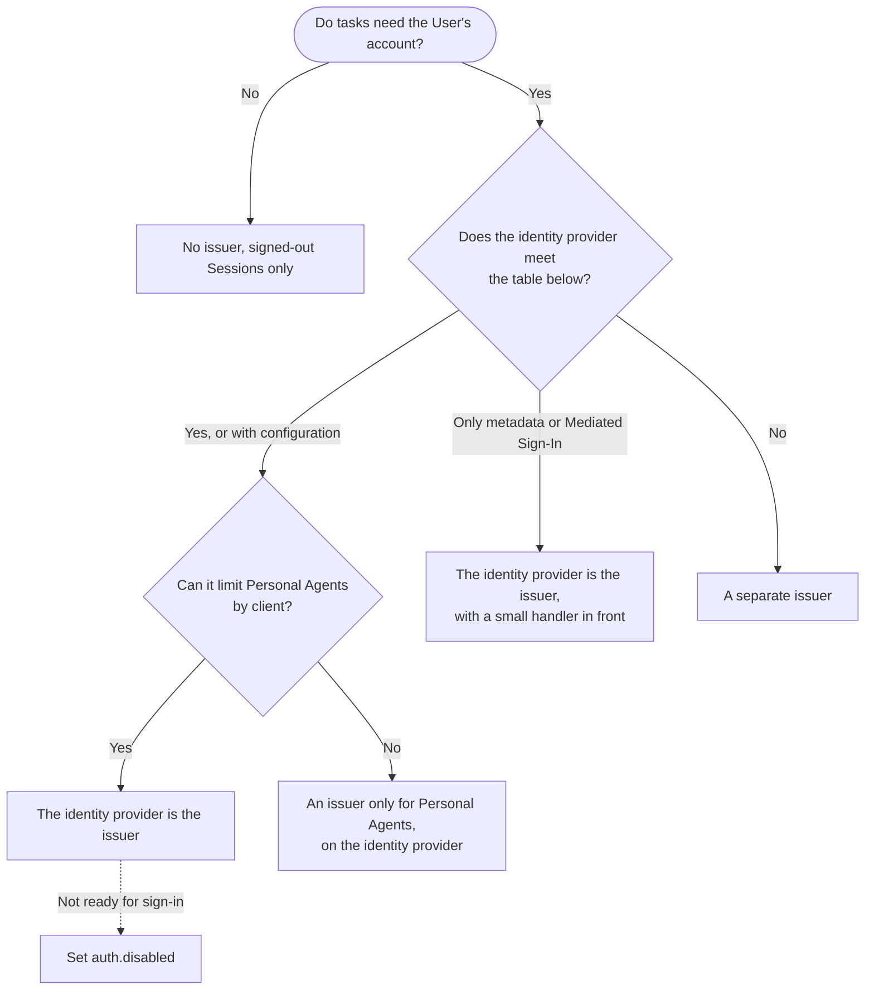
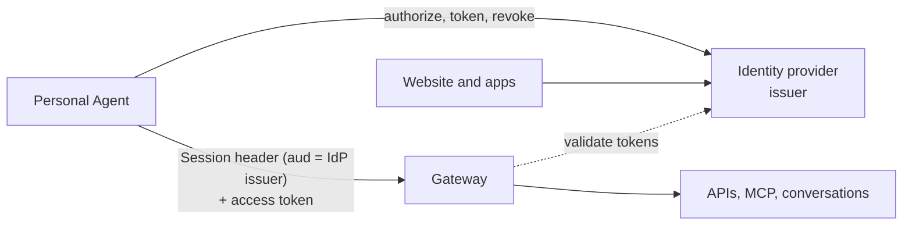
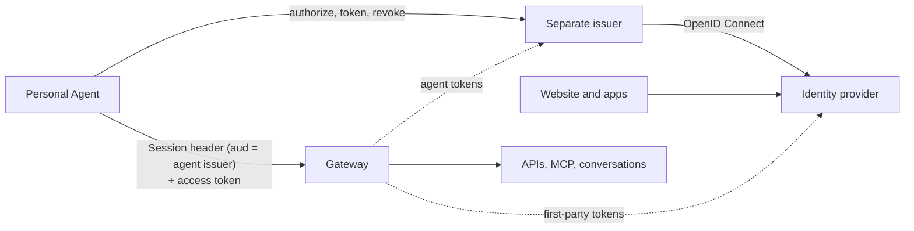
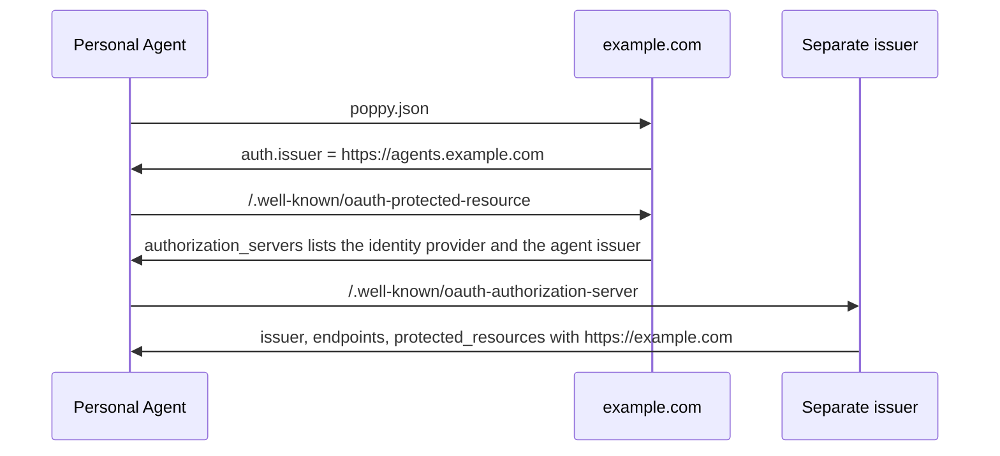
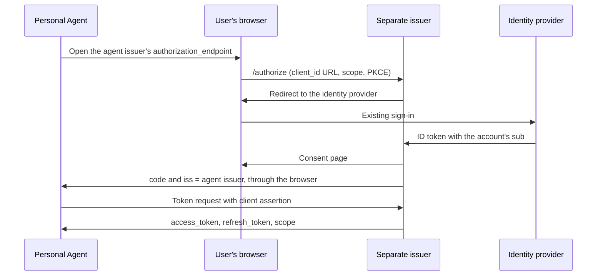
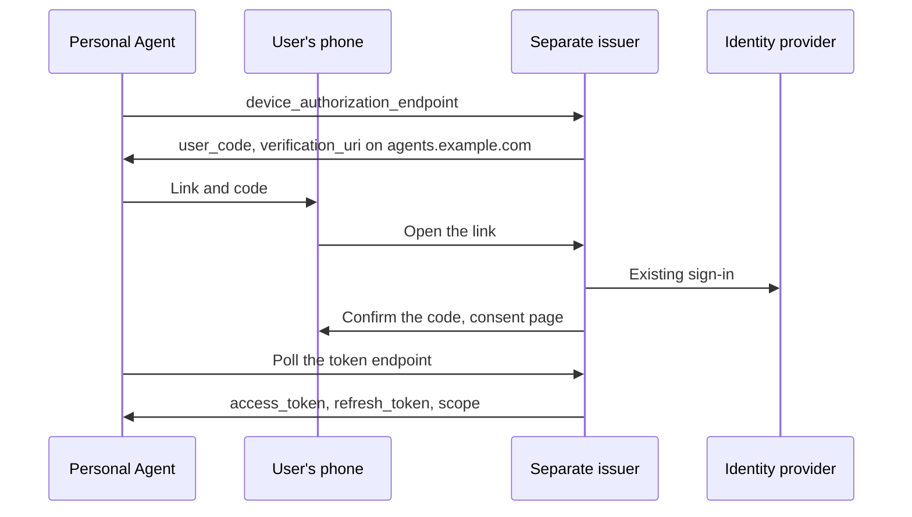
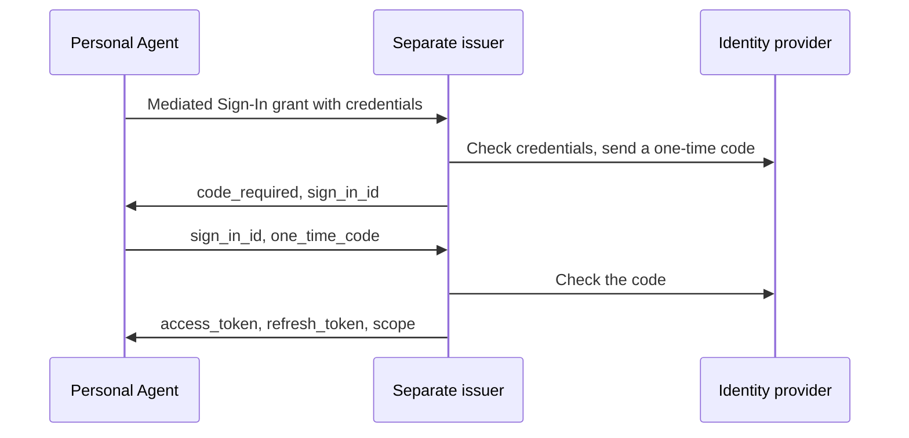
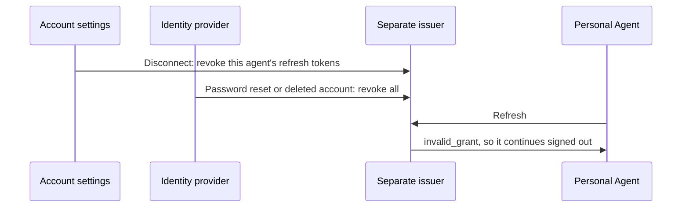

# Pattern: the issuer and an existing identity provider

Poppy sign-in is plain OAuth ([4](https://personalagentprotocol.org/docs/spec#oauth)), so a
Company's existing identity provider, such as a CIAM service, can usually stay in place. The choice
is which server Personal Agents use as the Company's issuer
([3.2](https://personalagentprotocol.org/docs/spec#oauth-server)):

- **No issuer.** The Company offers signed-out Sessions only, which rely on the Session header
  alone.
- **The identity provider is the issuer.** Personal Agents are one more OAuth client there. Until
  you're ready to let them sign in, set `auth.disabled`.
- **An issuer only for Personal Agents, on the identity provider.** For example,
  `https://auth.example.com/agents`, sharing accounts, servers, and keys with the main issuer.
- **A separate issuer.** Another OAuth server issues Personal Agents' tokens and signs Users in
  through the identity provider.

In every option with an issuer, Users sign in the way they do today.

Choose before launch. User IDs, Sessions, and refresh tokens belong to the issuer, so changing it
later makes every User sign in again
([3.2](https://personalagentprotocol.org/docs/spec#oauth-server)). If the domain's protected
resource metadata already names the identity provider, it is already the Company's identifier,
even for signed-out Sessions. Keep it and set `auth.disabled` rather than launch without it.

## What the issuer needs

Record each row in `plan/survey.md`.

| Requirement                                                                                                                                                                                             | If the identity provider can't                                             |
| ------------------------------------------------------------------------------------------------------------------------------------------------------------------------------------------------------- | -------------------------------------------------------------------------- |
| Clients identified by a client ID metadata document URL ([4.1](https://personalagentprotocol.org/docs/spec#agent-identity))                                                                             | Register the Personal Agents you accept by `client_id` URL. Reject others. |
| `private_key_jwt` with `ES256`, and assertion `aud` exactly the issuer ([4.1](https://personalagentprotocol.org/docs/spec#agent-identity))                                                              | A separate issuer.                                                         |
| PKCE `S256`, exact `redirect_uri` with loopback ports, `iss` in every redirect ([4.2](https://personalagentprotocol.org/docs/spec#direct-sign-in))                                                      | A separate issuer.                                                         |
| A refresh token from every sign-in, and no scopes beyond those requested ([4.4](https://personalagentprotocol.org/docs/spec#refresh-tokens), [4.7](https://personalagentprotocol.org/docs/spec#scopes)) | Usually configuration. Otherwise a separate issuer.                        |
| RFC 7009 revocation ([4.6](https://personalagentprotocol.org/docs/spec#revocation))                                                                                                                     | A separate issuer.                                                         |
| `grant_types_supported` and `protected_resources` in its metadata ([3.2](https://personalagentprotocol.org/docs/spec#oauth-server))                                                                     | A metadata handler, if the issuer is on your domain.                       |
| Tokens that say which `client_id` they were issued to ([5.3](https://personalagentprotocol.org/docs/spec#session-verification))                                                                         | Introspection.                                                             |
| The device grant, if you offer Device Sign-In ([4.3](https://personalagentprotocol.org/docs/spec#device-sign-in))                                                                                       | Offer Direct Sign-In only.                                                 |
| A custom grant, if you offer [Mediated Sign-In](https://personalagentprotocol.org/docs/extensions/mediated-sign-in)                                                                                     | A grant handler in front of the token endpoint.                            |

Resource indicators matter only for services that accept only their own tokens, such as MCP
servers. DPoP is optional.

## The identity provider is the issuer

- Needs: the metadata fields in [3.2](https://personalagentprotocol.org/docs/spec#oauth-server),
  protected resource metadata on each domain naming the provider, and a consent page that shows
  the Personal Agent's `client_id` domain (`patterns/sign-in.md`).
- Watch for: first-party scopes granted by default. Limit Personal Agents by client
  ([guides](https://personalagentprotocol.org/docs/guides#company-agent-issuer)). Leave `openid`
  out of `scopes_supported`, or describe it, since Personal Agents don't use ID tokens.

Two gaps can be closed with a small handler instead of a second issuer. If the issuer is on a
domain you control, a handler at the metadata URL can add `protected_resources` and
`grant_types_supported` to the provider's metadata. A handler at the token endpoint can take the
Mediated Sign-In grant, check credentials through the provider's API, and pass everything else
through, if the provider can issue tokens for a sign-in your server completed. A gap in the
authorization flow itself needs a separate issuer.

## An issuer only for Personal Agents, on the identity provider

If the identity provider can't limit scopes or sign-in by client, a second issuer on it, such as
`https://auth.example.com/agents`, can serve only Personal Agents. It shares accounts, servers, and
signing keys with the main issuer
([guides](https://personalagentprotocol.org/docs/guides#company-agent-issuer)). The domain's
protected resource metadata lists both issuers, and `auth.issuer` names this one, as in
[Discovery](#discovery) below.

## A separate issuer

A separate OAuth server, such as `https://agents.example.com`, meets
[4.8](https://personalagentprotocol.org/docs/spec#oauth-additions) itself and is an OpenID Connect
client of the identity provider.

- Needs: its own metadata, an OpenID Connect client at the identity provider, and resources and
  the website's browser-session `/authorize` endpoint that accept its tokens.
- Watch for: identifiers. Session JWTs use the new issuer as their audience
  ([5.1](https://personalagentprotocol.org/docs/spec#user-ids)). Put the identity provider's
  stable user ID in its tokens, never an email address.

If services behind the gateway accept only identity provider tokens, the gateway can pass them a
credential that allows no more than the agent token's scopes
([guides](https://personalagentprotocol.org/docs/guides#company-internal)).

### Discovery

If the domain's protected resource metadata lists both servers, `auth.issuer` names the one
Personal Agents use ([3.1](https://personalagentprotocol.org/docs/spec#fields)). Only that issuer's
metadata needs the domain in `protected_resources`.

### Direct Sign-In

The new issuer sends the User to the identity provider, then shows its own consent page. The
consent page appears even when the identity provider skips sign-in for a browser that's already
signed in.

### Device Sign-In

The verification page has to be on the new issuer's host or a protected resource's host, or a
subdomain of either ([4.3](https://personalagentprotocol.org/docs/spec#device-sign-in)). From there
it can send the User to the identity provider.

### Mediated Sign-In

If you offer the extension, its grant handler checks credentials and sends one-time codes through
the identity provider's APIs. Never store credentials or codes.

### Revocation

Users manage their account at the identity provider and their Personal Agents at the new issuer.
Disconnecting a Personal Agent in account settings revokes its tokens at the new issuer. A password
reset, compromise, or deleted account at the identity provider revokes them too, for example
through its webhooks ([guides](https://personalagentprotocol.org/docs/guides#company-lifetimes)).

A platform that runs the separate issuer for several Companies gives each its own issuer
([guides](https://personalagentprotocol.org/docs/guides#company-hosting)).
