# Pattern: the issuer and an existing identity provider

Most Companies already sign customers in through an identity provider, often a customer identity
(CIAM) service. Poppy sign-in is plain OAuth
([4](https://personalagentprotocol.org/docs/0.3/spec#oauth)), so that provider can usually stay in place.
The question is which server Personal Agents treat as the Company's issuer
([3.2](https://personalagentprotocol.org/docs/0.3/spec#oauth-server)):

- **The identity provider is the issuer.** Personal Agents get their tokens from the provider your
  website and apps already use.
- **An issuer for Personal Agents, alongside the identity provider.** A separate OAuth server
  handles Personal Agents, and sends Users to your identity provider to sign in. Your identity
  provider stays the source of accounts and sign-in methods.

Both keep the User's sign-in, MFA, and fraud checks where they are today. Signed-out Sessions need
neither: they rely on the Session header alone, and no identity provider sees them
([5.3](https://personalagentprotocol.org/docs/0.3/spec#session-verification)).

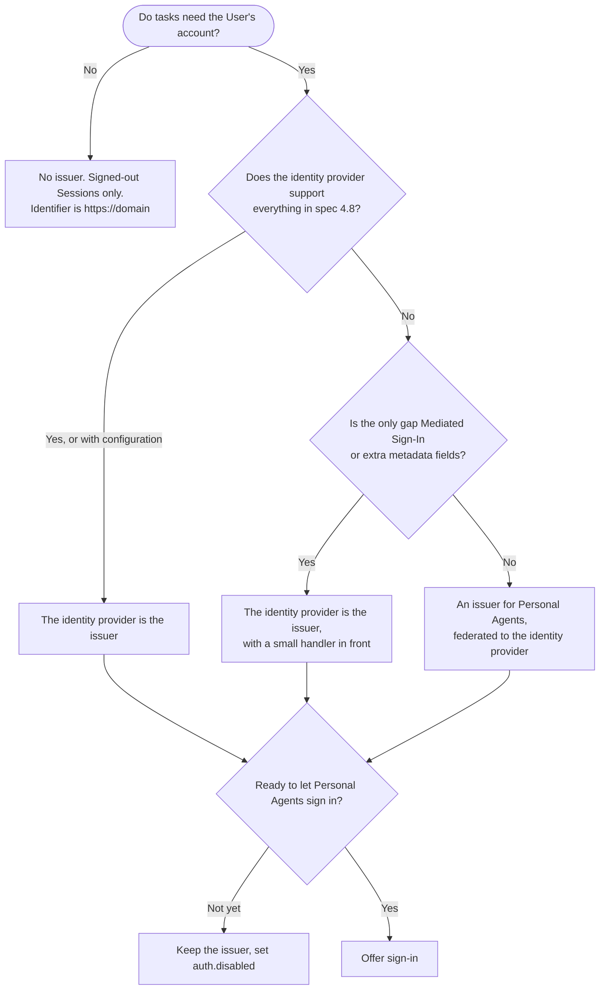

**Choose before launch.** User IDs, Sessions, and refresh tokens belong to the issuer
([3.2](https://personalagentprotocol.org/docs/0.3/spec#oauth-server)). Moving from one pattern to the
other later changes the Company's identifier, so every User signs in again and earlier Sessions
don't carry over. This applies even to a Company that offers only signed-out Sessions today, if
its domain's protected resource metadata already names the identity provider: that provider is
already its identifier.

## What the issuer has to support

Check the identity provider against this list in the survey. Each row is something
[4.8](https://personalagentprotocol.org/docs/0.3/spec#oauth-additions) adds to OAuth, or a requirement
of [3.2](https://personalagentprotocol.org/docs/0.3/spec#oauth-server).

| Requirement                                                                        | Spec                                                                                   | If the identity provider can't                                                                           |
| ---------------------------------------------------------------------------------- | -------------------------------------------------------------------------------------- | -------------------------------------------------------------------------------------------------------- |
| Clients identified by a client ID metadata document URL                            | [4.1](https://personalagentprotocol.org/docs/0.3/spec#agent-identity)                      | Register each Personal Agent you accept by its `client_id` URL, and reject others with `invalid_client`. |
| `private_key_jwt` with keys from `jwks_uri`, `ES256` required                      | [4.1](https://personalagentprotocol.org/docs/0.3/spec#agent-identity)                      | An issuer for Personal Agents.                                                                           |
| Client assertion `aud` exactly the issuer, rejecting the token endpoint URL        | [4.1](https://personalagentprotocol.org/docs/0.3/spec#agent-identity)                      | An issuer for Personal Agents.                                                                           |
| `iss` in every authorization response, including errors (RFC 9207)                 | [4.2](https://personalagentprotocol.org/docs/0.3/spec#direct-sign-in)                      | An issuer for Personal Agents.                                                                           |
| PKCE with `S256`, exact `redirect_uri` matching, loopback ports (RFC 8252)         | [4.2](https://personalagentprotocol.org/docs/0.3/spec#direct-sign-in)                      | An issuer for Personal Agents.                                                                           |
| A refresh token from every sign-in, rotation as RFC 6749 §6 allows                 | [4.4](https://personalagentprotocol.org/docs/0.3/spec#refresh-tokens)                      | Usually configuration. Otherwise an issuer for Personal Agents.                                          |
| No scopes beyond those requested, and at least one granted                         | [4.7](https://personalagentprotocol.org/docs/0.3/spec#scopes)                              | Usually configuration. Otherwise an issuer for Personal Agents.                                          |
| RFC 7009 revocation, listed as `revocation_endpoint`                               | [4.6](https://personalagentprotocol.org/docs/0.3/spec#revocation)                          | An issuer for Personal Agents.                                                                           |
| `grant_types_supported` with `refresh_token`, and `protected_resources` (RFC 9728) | [3.2](https://personalagentprotocol.org/docs/0.3/spec#oauth-server)                        | If the issuer is on your own domain, a handler can serve the metadata with these fields. See below.      |
| Resources can tell which `client_id` a token was issued to                         | [5.3](https://personalagentprotocol.org/docs/0.3/spec#session-verification)                | A claim such as `client_id` or `azp`, or introspection.                                                  |
| Resource indicators (RFC 8707), for MCP servers                                    | [4.5](https://personalagentprotocol.org/docs/0.3/spec#access-tokens)                       | Needed only for services that accept only their own tokens.                                              |
| The device authorization grant, if you offer Device Sign-In                        | [4.3](https://personalagentprotocol.org/docs/0.3/spec#device-sign-in)                      | Offer Direct Sign-In only, or an issuer for Personal Agents.                                             |
| A custom grant type, if you offer Mediated Sign-In                                 | [Mediated Sign-In](https://personalagentprotocol.org/docs/0.3/extensions/mediated-sign-in) | A grant handler in front of the token endpoint. See below.                                               |
| DPoP-bound access tokens (optional)                                                | [4.5](https://personalagentprotocol.org/docs/0.3/spec#access-tokens)                       | Issue Bearer tokens. Verifying the Session header and its `ath` binds them to the Personal Agent's key.  |

Record each row's answer, with evidence, in `plan/survey.md`.

## The identity provider is the issuer

Personal Agents are one more kind of OAuth client at the provider your website already uses.

- Fits: an identity provider that supports the table above, or needs only configuration.
- Needs: the provider's metadata with the fields in
  [3.2](https://personalagentprotocol.org/docs/0.3/spec#oauth-server), protected resource metadata on
  each domain naming the provider in `authorization_servers`, a consent page that shows the
  Personal Agent's `client_id` domain (`patterns/sign-in.md`), and Poppy's scopes in the provider.
- Watch for: an `openid` scope in `scopes_supported`. Personal Agents don't need ID tokens. Leave
  it out of the list, or describe it in `auth.scopes`
  ([4.7](https://personalagentprotocol.org/docs/0.3/spec#scopes)). Also watch for a provider that
  grants first-party apps' scopes by default. Limit what Personal Agents get by client, or with
  `unauthorized_client` ([guides](https://personalagentprotocol.org/docs/0.3/guides#company-agent-issuer)).

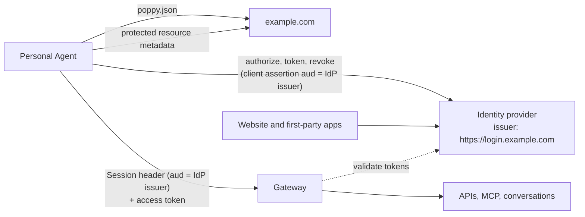

Direct Sign-In then looks like this. The User signs in with any method the provider already offers
([4.2](https://personalagentprotocol.org/docs/0.3/spec#direct-sign-in)).

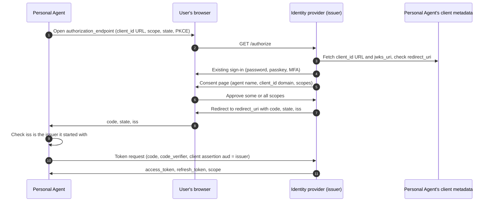

### Small handlers in front of the identity provider

Two gaps can be closed without a second issuer:

- **Metadata fields.** If the issuer is on a domain you control, such as a custom domain for the
  provider, a handler at the RFC 8414 metadata URL can serve the provider's metadata with
  `protected_resources` and `grant_types_supported` added. The `issuer` and every endpoint stay
  exactly as the provider serves them. Keep it in step with the provider's own metadata.
- **Mediated Sign-In.** A grant handler at the token endpoint recognizes the Mediated Sign-In grant
  type, checks credentials through the provider's API, and returns tokens the provider issues for
  that account. It works only if the provider can issue tokens for a sign-in your server completed.
  It passes every other request to the provider unchanged (`patterns/sign-in.md`).

A gap in the authorization flow itself, such as `iss` in redirects or the client assertion's
audience, needs an issuer for Personal Agents instead. A proxy that rewrites authorization requests
and responses is an issuer in all but name, and harder to keep correct.

## An issuer for Personal Agents, alongside the identity provider

A separate OAuth server, such as `https://agents.example.com`, is the Company's issuer for Personal
Agents. It meets [4.8](https://personalagentprotocol.org/docs/0.3/spec#oauth-additions) itself, and it
signs Users in through your identity provider with OpenID Connect, as one more client of the
provider. Your website, apps, and accounts keep using the identity provider directly.

- Fits: an identity provider that can't meet the table above, or a Company that wants Personal
  Agent clients, consent, and tokens kept apart from first-party ones.
- Needs: the new server's metadata and the domain's protected resource metadata
  ([3.2](https://personalagentprotocol.org/docs/0.3/spec#oauth-server)); an OpenID Connect client at the
  identity provider for the new server; a stable account ID from the provider in the new server's
  tokens; resources that accept the new server's tokens; and revocation when the account changes
  (below).
- Watch for: the identifiers. The Company's identifier is the new issuer, so Session JWTs use it as
  their audience and User IDs are scoped by it
  ([5.1](https://personalagentprotocol.org/docs/0.3/spec#user-ids)). Map the provider's stable user ID
  to your account, never an email address, which can change or be reused.

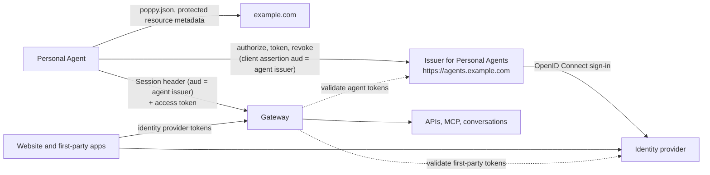

### Discovery with two authorization servers

If the domain's protected resource metadata lists only the new issuer, Personal Agents use it. If it
lists both servers, for example because other clients find the identity provider there, `auth.issuer`
in `poppy.json` names the one Personal Agents use
([3.1](https://personalagentprotocol.org/docs/0.3/spec#fields)). Either way, Personal Agents check
`protected_resources` only in the new issuer's metadata, so it has to list the domain.

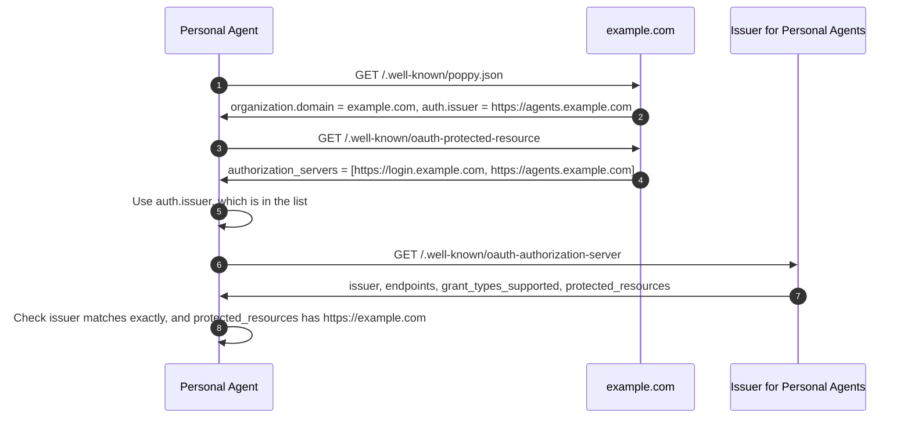

### Direct Sign-In through the identity provider

The new issuer's authorization endpoint sends the User to the identity provider to sign in, then
shows its own consent page. The identity provider's sign-in page can be on any host
([4.2](https://personalagentprotocol.org/docs/0.3/spec#direct-sign-in)).

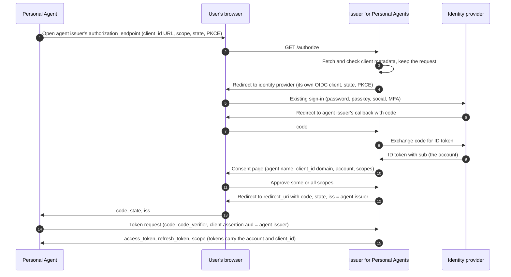

The identity provider may skip its sign-in step when the browser is already signed in. The consent
page still appears on every Poppy sign-in, so the User approves the Personal Agent's scopes each
time.

### Device Sign-In through the identity provider

The verification page has to be on the new issuer's host, or on the host of a URL in its
`protected_resources`, or a subdomain of either. Personal Agents check this before showing the link
([4.3](https://personalagentprotocol.org/docs/0.3/spec#device-sign-in)). The page can then send the
User to the identity provider.

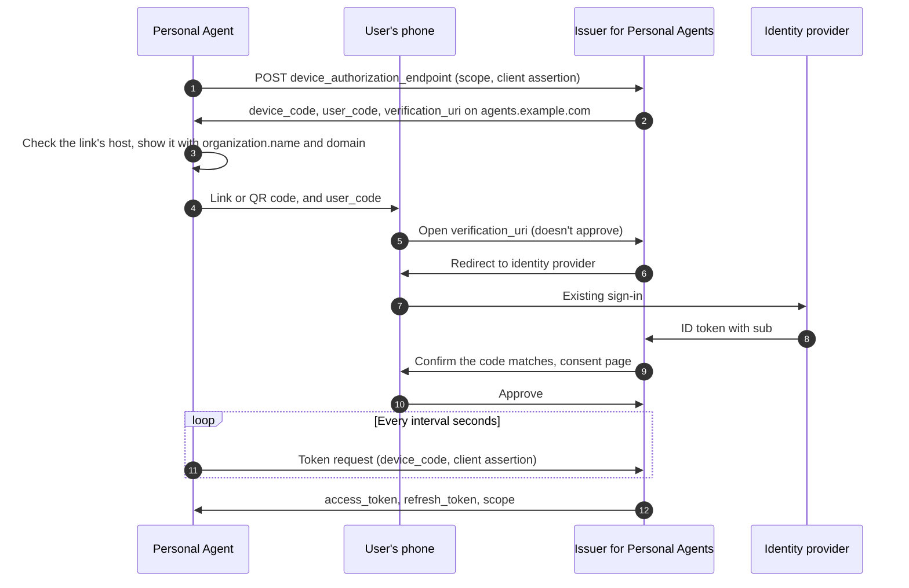

### Mediated Sign-In through the identity provider

If you offer the extension, the new issuer's grant handler checks credentials and sends one-time
codes through the identity provider's APIs
([Mediated Sign-In](https://personalagentprotocol.org/docs/0.3/extensions/mediated-sign-in)). Never
store the credentials or codes, including in logs.

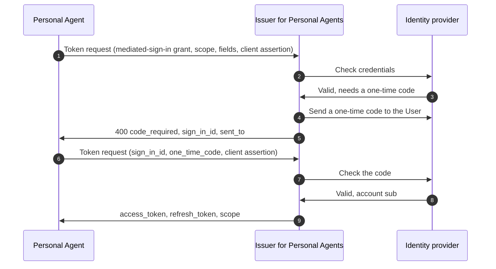

### Resources accept both issuers' tokens

Resources that Personal Agents call accept the new issuer's tokens, in addition to the identity
provider's tokens from your own apps. Verify both at a gateway, then pass the verified account and
scopes to the services behind it
([guides](https://personalagentprotocol.org/docs/0.3/guides#company-internal)). If services behind it
accept only identity provider tokens, the gateway can exchange a verified agent token for an
internal credential that allows no more than the agent token's scopes.

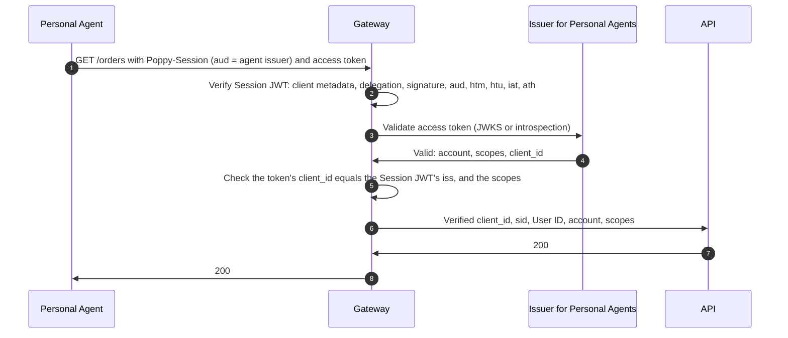

### Browser join

Your website accepts the new issuer's access tokens at `{browser_session_endpoint}/authorize`
([section 6](https://personalagentprotocol.org/docs/0.3/spec#web-browsing)). It then sets its own
Session cookie and checks that cookie before the identity provider's login, so the Personal Agent's
browser acts with the token's account and scopes.

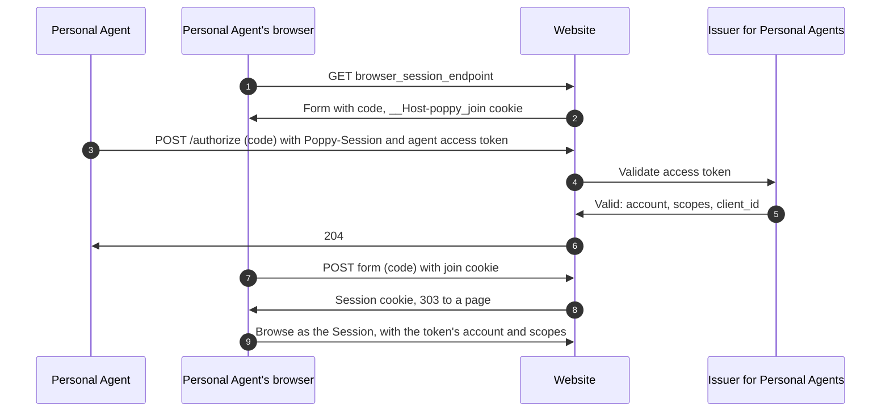

### Keeping the account in step

Users manage their account at the identity provider, and their Personal Agents at the new issuer.
Connect the two:

- List connected Personal Agents in your account settings from the new issuer's records, and
  revoke there when the User disconnects one
  ([guides](https://personalagentprotocol.org/docs/0.3/guides#company-account-settings)).
- Revoke the account's refresh tokens at the new issuer when the identity provider reports a
  password reset, a suspected compromise, or a deleted or locked account, for example from its
  event webhooks ([guides](https://personalagentprotocol.org/docs/0.3/guides#company-lifetimes)).

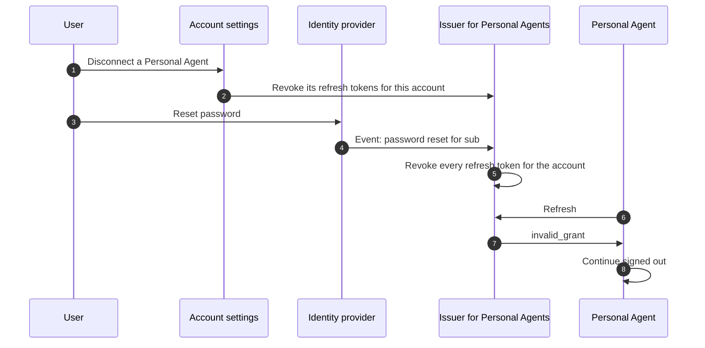

## Several Companies on one identity provider

A provider that hosts several Companies gives each its own issuer, such as
`https://agents.provider.example/shop-a`, even on shared servers
([3.2](https://personalagentprotocol.org/docs/0.3/spec#oauth-server),
[guides](https://personalagentprotocol.org/docs/0.3/guides#company-hosting)). Each issuer's
`protected_resources` lists only its own Company's domains, and a token from one never works at
another.
